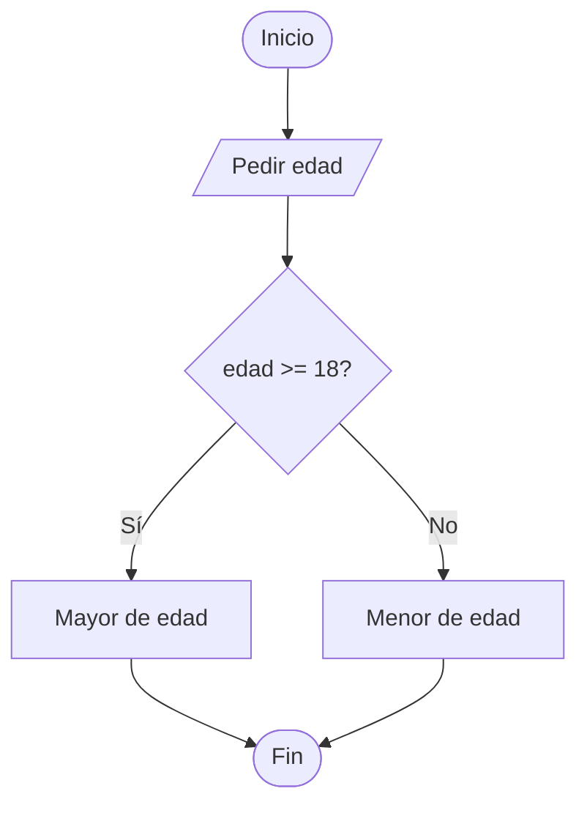

# Tema 5 — Tomar decisiones: algoritmos, diagramas e `if`


## Índice
1. [Un algoritmo es una receta](#1-un-algoritmo-es-una-receta)
2. [`if`: hacer algo solo si…](#2-if-hacer-algo-solo-si)
3. [`if` – `else`: dos caminos](#3-if--else-dos-caminos)
4. [Escribir buenas condiciones](#4-escribir-buenas-condiciones)
5. [Variables dentro de las llaves (ámbito)](#5-variables-dentro-de-las-llaves-ámbito)
6. [Errores típicos](#6-errores-típicos)

---

## 1. Un algoritmo es una receta

Hasta ahora todos los programas hacían **siempre lo mismo, en orden** (secuencia).
Ahora el programa va a **decidir**. Antes de programar, se piensa en pasos (pseudocódigo)
y, si ayuda, se dibuja el **diagrama de flujo** (el rombo es la decisión):

```
Pedir edad
SI edad >= 18 ENTONCES
    mostrar "Eres mayor de edad"
SI NO
    mostrar "Eres menor de edad"
FIN SI
```



Las tres estructuras con las que se construye **cualquier** algoritmo son:
**secuencia** (lo que ya sabes), **selección** (este bloque) y **repetición** (más adelante en el 2º trimestre).

---

## 2. `if`: hacer algo solo si…

```java
if (condición) {
    // se ejecuta SOLO si la condición es true
}
```

La condición es una expresión **booleana** (¡la misma de los operadores del Tema 4!).

<!--in: 20-->
```java
import java.util.Scanner;

public class MayorEdad {
    public static void main(String[] args) {
        Scanner sc = new Scanner(System.in);

        System.out.print("Edad: ");
        int edad = sc.nextInt();

        if (edad >= 18) {
            System.out.println("Eres mayor de edad");
        }
        System.out.println("Fin del programa");   // esto se ejecuta SIEMPRE
    }
}
```

Con `20` sale las dos líneas; con `15` solo `Fin del programa`.

---

## 3. `if` – `else`: dos caminos

```java
if (condición) {
    // camino 1: la condición es true
} else {
    // camino 2: la condición es false
}
```

Siempre se ejecuta **uno y solo uno** de los dos caminos.

<!--in: 7-->
```java
import java.util.Scanner;

public class ParImpar {
    public static void main(String[] args) {
        Scanner sc = new Scanner(System.in);

        System.out.print("Número: ");
        int numero = sc.nextInt();

        if (numero % 2 == 0) {
            System.out.println(numero + " es par");
        } else {
            System.out.println(numero + " es impar");
        }
    }
}
```

> 💡 `%` es el resto de la división. Si el resto de dividir entre 2 es 0, es par.

---

## 4. Escribir buenas condiciones

| Quiero comprobar… | Condición |
|---|---|
| igual / distinto | `a == b` · `a != b` |
| mayor / menor | `a > b` · `a < b` · `a >= b` · `a <= b` |
| entre dos valores | `x >= 18 && x < 65` |
| uno **u** otro | `x == 1 \|\| x == 2` |
| lo contrario | `!(x > 5)` |
| **texto** igual | `texto.equals("sí")` |
| un **char** igual | `letra == 'a'` |

<!--in: 15 sí-->
```java
import java.util.Scanner;

public class Condiciones {
    public static void main(String[] args) {
        Scanner sc = new Scanner(System.in);

        System.out.print("Edad: ");
        int edad = sc.nextInt();
        System.out.print("¿Tienes carnet? (si/no): ");
        String respuesta = sc.next();

        if (edad >= 18 && respuesta.equals("si")) {
            System.out.println("Puedes conducir");
        } else {
            System.out.println("No puedes conducir");
        }
    }
}
```

> ⚠️ Los textos (`String`) **nunca** se comparan con `==`; se usa `equals()` (lo viste en el Tema 2).

---

## 5. Variables dentro de las llaves (ámbito)

Una variable declarada **dentro** de unas llaves `{ }` solo existe ahí dentro:

```java
int edad = 20;
if (edad >= 18) {
    String mensaje = "Mayor";   // nace aquí...
}
System.out.println(mensaje);    // ❌ error: cannot find symbol (...y muere aquí)
```

Solución: declararla **antes** del `if` y asignarla dentro.

<!--in: 20-->
```java
import java.util.Scanner;

public class Ambito {
    public static void main(String[] args) {
        Scanner sc = new Scanner(System.in);
        int edad = sc.nextInt();

        String mensaje;                 // declarada fuera
        if (edad >= 18) {
            mensaje = "Mayor";
        } else {
            mensaje = "Menor";
        }
        System.out.println(mensaje);    // ✅ funciona
    }
}
```

---

## 6. Errores típicos

| Error | Qué pasa | Correcto |
|---|---|---|
| `if (x = 5)` | **no compila** (asigna en vez de comparar) | `if (x == 5)` |
| `if (x > 5);` | el `;` cierra el `if`: las llaves siguientes se ejecutan **siempre** | `if (x > 5) {` |
| `if (nombre == "Ana")` | compara referencias, falla | `nombre.equals("Ana")` |
| `if (5 < x < 10)` | no compila | `x > 5 && x < 10` |
| Olvidar las llaves | solo la 1ª línea es del `if` | poner **siempre** `{ }` |
